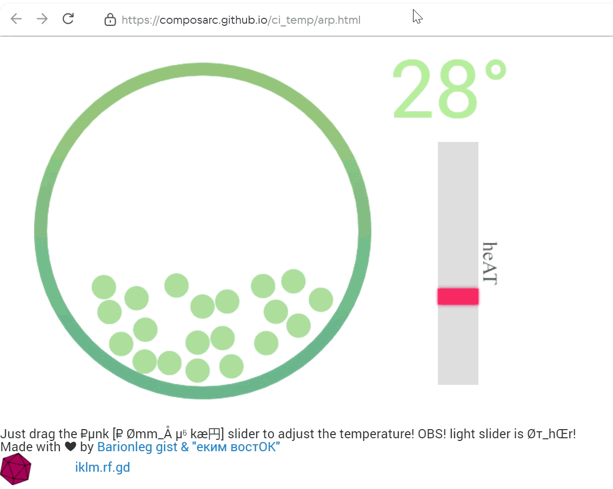

# ci_temp [Re-template](https://github.com/uoxyc/ci_temp/generate)

# ci_temp A₽p html [[hимик тАбЛи©А℞ мен'Де Лёв](https://aibolem.github.io/00/)]

Temperature Simulation (Visualisation on molecular stage)
----------------------
[inde_ხ](https://uoxyc.github.io/ci_temp/index.html) 

A small visualization of particles and their reactions to different temperatures created in HTML5 and JavaScript.

A [Pen](https://codepen.io/barionleg/pen/ExrBmBg) by [Bankn8II©$A](https://codepen.io/barionleg) on [CodePen](https://codepen.io).

[License](https://codepen.io/license/pen/ExrBmBg).
